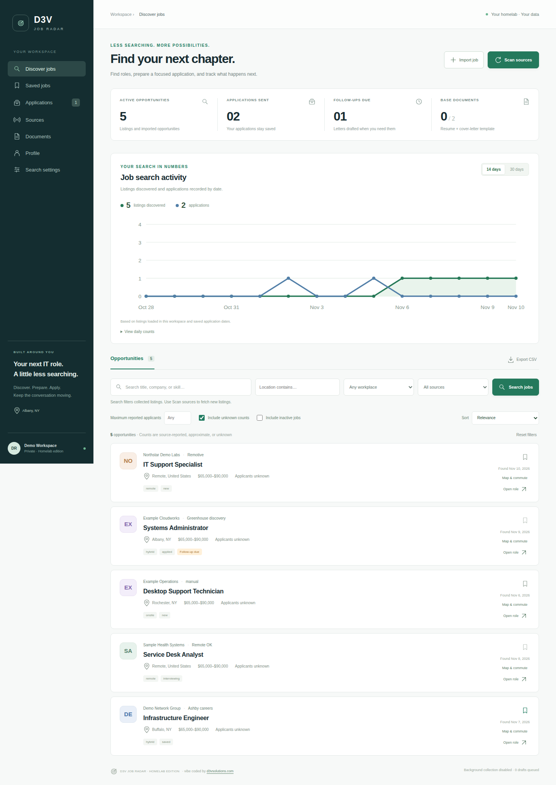
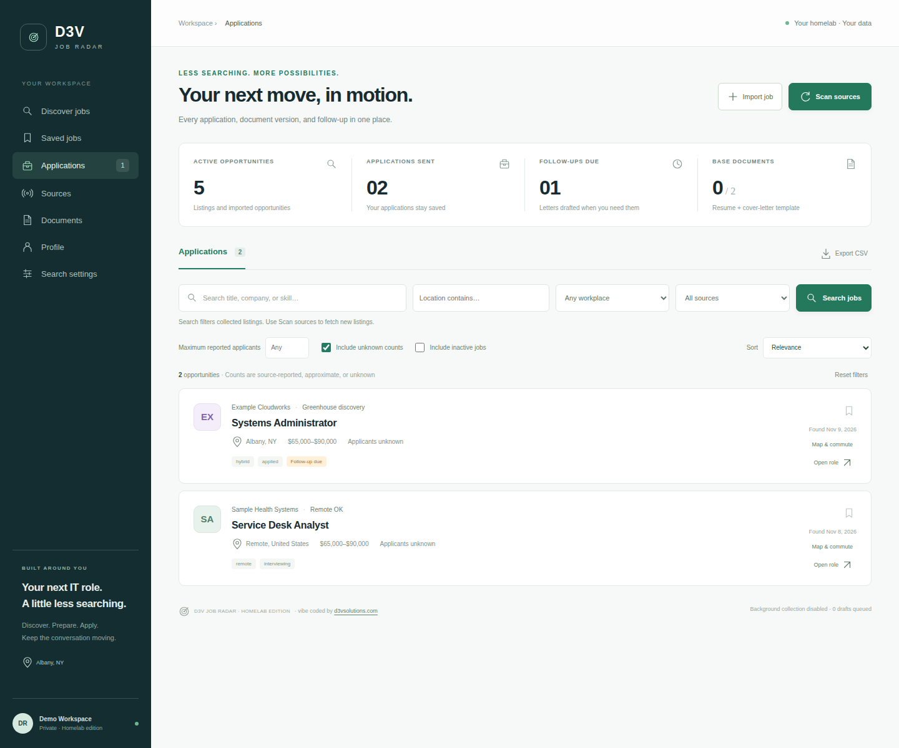
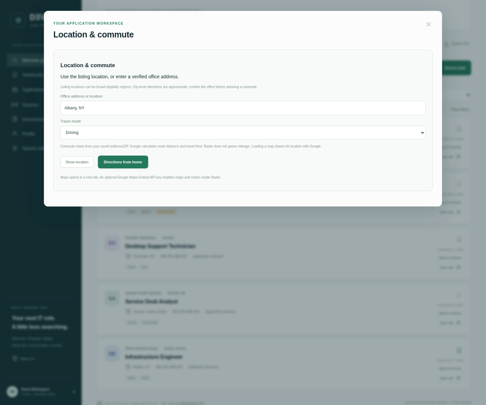
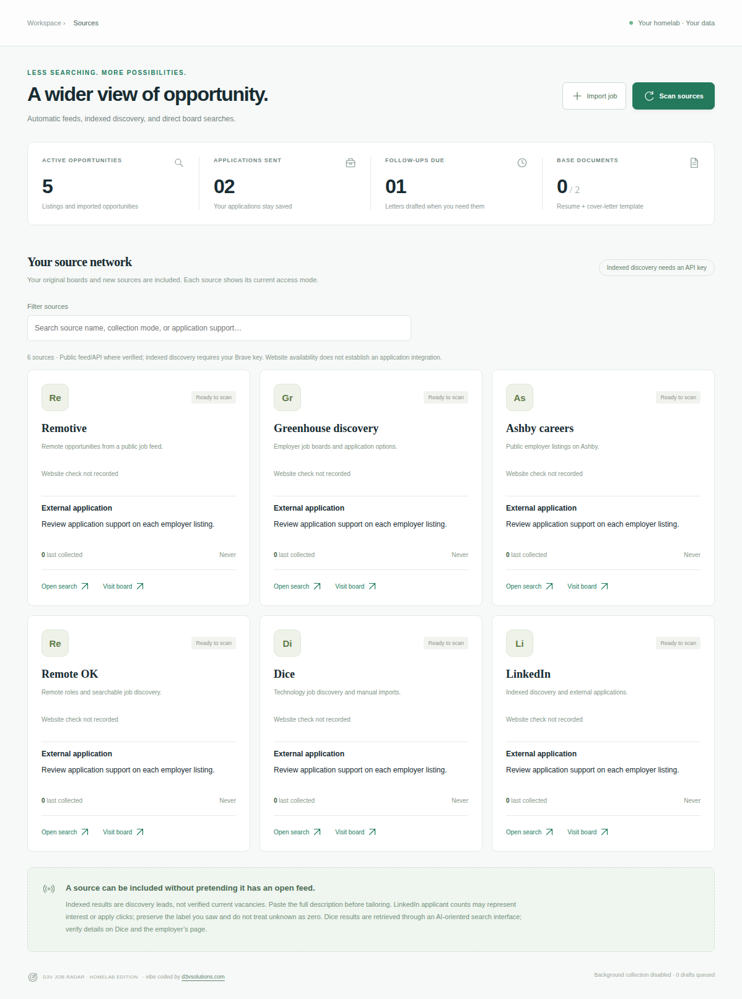

# D3V Radar

Private, self-hosted job discovery and application tracking for your homelab.

Radar combines job sources, location and remote filters, resume and cover-letter
uploads, job-specific draft preparation, application history, follow-up drafts,
and dashboard statistics. Manual imports fetch job details where the source permits.
A Chrome extension helps fill recognized application questions with reviewed profile answers.

Version **2.7.0** adds private beta workspaces per approved login. Read
[BETA.md](BETA.md) before inviting friends; the existing workspace stays assigned
to its configured owner. Shared public-feed caching keeps personal records separate.

Google Maps links and directions for job locations, optional
embedded maps, and an encrypted home-address setting are included. See [MAPS.md](MAPS.md).
Exact travel distance is shown by Google Maps; Radar does not invent distances.

## Screenshots

Captured from Radar 2.6 with fictional demo jobs and application records.
Companies, counts, salaries, and locations illustrate the interface; these are not
live vacancies or a real applicant history. The source view is an illustrative subset.

### Discover jobs and search activity



### Application tracking



### Location and commute tools



Google Maps opens on demand. The screenshot shows the controls without an embedded
map or a claimed travel distance; an Embed API key is optional.

### Source network



Maintainers can regenerate these images using the **Demo screenshots** workflow
in GitHub Actions. It uses isolated fixtures and never contacts a homelab.

## Existing homelab: move from ZIP updates to GitHub

Keep your existing `~/jobradar` installation, `.env`, encryption key, and Docker volume.
Clone this repository into a **separate** directory on the Ubuntu server:

```bash
git clone https://github.com/d3vlabs2/d3vradar.git ~/d3vradar-source
bash ~/d3vradar-source/deploy/update-homelab.sh ~/jobradar
```

The updater pulls main without resetting local changes, requires successful GitHub
CI for that exact commit, backs up changed code, and recreates the existing Compose
service. It preserves .env and the data volume. Keep a secure separate backup of
.env: its encryption key is required to decrypt existing documents and profiles.
The updater also saves a database archive before replacing code. Keep secure
off-host backups of that archive and the matching .env. See [BETA.md](BETA.md) for
backup coverage and owner settings.

For every future update, run:

```bash
bash ~/d3vradar-source/deploy/update-homelab.sh ~/jobradar
```

This is a manual deployment command. GitHub Actions tests changes; it does not
connect to or deploy into your homelab. If CI is pending or fails, the installed
application is left unchanged. Review the Actions page before retrying.

## New installation

Requires Python 3, Docker Engine, Docker Compose, and Git.

```bash
git clone https://github.com/d3vlabs2/d3vradar.git ~/jobradar
cd ~/jobradar
bash deploy/start.sh
```

Configure a Cloudflare Access self-hosted application for your chosen hostname and
an allow policy for your email before exposing the app. The setup script asks for
your hostname origin, Access team domain, application AUD, and allowed email.
The application validates Access tokens itself. Keep the service bound to
127.0.0.1:3740 and use Cloudflare Tunnel for access.

For an existing locally managed tunnel, add the route using your hostname:

```bash
sudo python3 deploy/add_ingress.py /etc/cloudflared/config.yml --hostname radar.example.com
sudo cloudflared tunnel --config /etc/cloudflared/config.yml ingress validate
```

Follow the printed DNS route command and restart cloudflared after validation.
The route helper preserves a timestamped config backup and existing routes.

For loopback-only development, use `python3 deploy/configure.py --local` instead
of the protected setup and then `sudo docker compose up -d --build`. Read the local
token from .env and enter it in the preview sign-in box. Keep local mode on loopback.

## Sources and application support

See [APPLICATION_SOURCES.md](APPLICATION_SOURCES.md) for the reviewed source catalog.
Public feeds and ATS interfaces are used where available; indexed discovery needs
a Brave Search API key in BRAVE_SEARCH_API_KEY. Some sites require manual opening
or imports. Listing a source does not mean every job can be fetched or applied to.
Sources may change their interfaces or access requirements.

The scheduler scans every 12 hours while the app is running. Use the Discover
search button for an immediate search. Review your profile and all answers before
using the extension. Fresh installs have no personal profile; confirm citizenship,
authorization, and other answers yourself before exporting an answer pack.

Install the `extension` folder through Chrome Extensions → Developer mode → Load
unpacked. Import the exported JSON answer pack using the extension popup file
picker. Recognized questions can be filled on supported application pages.
Session answers are cleared when the browser session ends or you click Clear.

Applications can stay inside Radar only where the employer supports the available
embedded or submission flow. Other sources open their application page. Review
final materials and confirm submission; generating a draft does not apply for a job.
Resume tailoring must stay faithful to your actual experience and cannot guarantee
ATS acceptance. Marking a job applied defaults to today's date and allows edits.

## Development and checks

```bash
python3 -m venv .venv
source .venv/bin/activate
pip install -r requirements-dev.txt
python -m pytest -q
npm test
python deploy/check_public_tree.py
```

GitHub Actions runs these checks and builds the Docker image on GitHub-hosted
runners for pull requests and main pushes. Work on a feature branch, open a pull
request, review checks, merge, then run the homelab updater.
See [CONTRIBUTING.md](CONTRIBUTING.md) and [VERIFICATION.md](VERIFICATION.md).

Vibe coded by [D3V Solutions](https://www.d3vsolutions.com).
